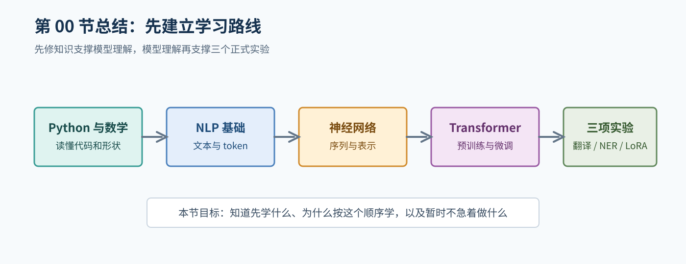

# 00. 课程路线与学习方法

## 1. NLP 到底研究什么

自然语言处理（Natural Language Processing, NLP）研究如何让计算机处理人类语言。这里的“处理”不是单一任务，而是一组不同的问题：

- 计算机如何把文字切成可以计算的单位？
- 一句话表达了什么意义？
- 句子中的人名、地点和机构在哪里？
- 一种语言如何转换成另一种语言？
- 模型如何根据前文生成回答？

同一段文本可以对应不同任务。例如：

```text
输入：张三在北京大学学习机器学习。
```

- 文本分类：判断这句话属于哪个主题。
- NER：识别“张三”和“北京大学”的实体类别。
- 依存分析：分析“学习”和“机器学习”等词之间的句法关系。
- 翻译：把整句话转换成另一种语言。
- 语言生成：根据前缀继续写下一个词。

因此，学习 NLP 的第一步不是背模型名称，而是先问：输入是什么，输出是什么，监督信号是什么，评价标准是什么。

## 2. 本课程的知识链路

本手册采用下面的链路：

```text
文本
  -> 规范化和切分
  -> token / token id
  -> 向量表示
  -> 模型计算
  -> logits 或生成文本
  -> 后处理
  -> 指标和错误分析
```

机器翻译、NER 和数学题 LoRA 看起来差异很大，但都可以放进这条链路中：

| 环节 | 机器翻译 | NER | 数学 LLM |
| --- | --- | --- | --- |
| 输入 | 源语言句子 | token 序列 | 题目 prompt |
| 输出 | 目标语言序列 | 每个位置的标签 | 回答文本 |
| 模型 | Encoder-Decoder Transformer | BERT + 分类头 | 自回归模型 + LoRA |
| 训练目标 | 预测下一个目标 token | 预测每个 token 的标签 | 预测回答 token |
| 主要指标 | BLEU 等 | 实体级 P/R/F1 | Accuracy |

## 3. 推荐的学习节奏

如果你没有学过 NLP，可以按照“理解、手算、实现、验证”的顺序：

### 第一步：理解对象

先明确一句话中的词、token、标签、向量、logit 和概率分别是什么。不要在还不知道输入形状时直接读训练脚本。

### 第二步：手算一个极小例子

例如只使用三个词的词表，手工写出 token id；或者使用两个实体，手工写出 BIO 标签。手算不需要复杂数学，但能暴露“标签和位置没有对齐”等问题。

### 第三步：运行最小代码

用很小的数据集完成一次前向计算，打印输入、输出和形状。然后做一个过拟合测试：只给模型少量样本，观察它是否能记住这些样本。

### 第四步：再扩展规模

只有当数据、mask、loss、保存和评估都通过小测试后，才考虑增加数据、模型或训练轮数。完整训练可能消耗大量时间和显存，不能把“命令运行过”误认为“实验已经可信”。

## 4. 后续章节的学习目标

下面的内容只是阅读导航，不是本章自测，也不要求现在回答。第 01 节到第 12 节会按学习顺序逐步说明：

- 原始字符串需要经过 token 化和数值表示，才能进入模型计算。
- token id 只是词表索引，不能直接当成有序数值特征。
- 训练集、验证集和测试集分别承担什么作用。
- 分类、序列标注和文本生成的输入输出形状有什么差别。
- loss、metric 和错误分析分别用于判断什么。
- 单个高分指标为什么不能自动证明模型可靠。

## 5. 面向零基础读者的记号约定

本手册使用以下符号：

- `B`：batch size，一次处理的样本数。
- `L`：sequence length，token 序列长度。
- `V`：vocabulary size，词表大小。
- `H`：hidden size，隐藏向量维度。
- `C`：类别数，例如 NER 标签数。
- `d_k`：attention 中 Key 向量的维度。

当看到：

```text
input_ids.shape = (B, L)
hidden.shape     = (B, L, H)
logits.shape     = (B, L, C)
```

可以按维度读成：每个 batch 有 `B` 条样本，每条样本有 `L` 个位置，每个位置有 `H` 维表示，最后对 `C` 个类别打分。

## 6. 本章暂不安排自测

第 00 节是课程路线和学习方法的总览，不是正式的知识学习章节。此时你还没有学完 Python、数学、token 化、神经网络和评价指标等必要基础，因此暂时不要求回答 NER、机器翻译或 LoRA 相关问题，也不要求画模型流程图。

现在只需要完成三件事：

1. 看懂第 3 节的学习顺序，知道后面会先补先修知识，再学习 NLP、神经网络、Transformer 和预训练模型。
2. 阅读第 5 节的记号约定，遇到 `B`、`L`、`V`、`H`、`C` 时先知道它们是“以后会用到的符号”，不要求现在掌握。
3. 在阅读过程中记下看不懂的术语，带着这些问题进入第 01 节；不要为了通过本章而提前背结论。

## 7. 本章暂不布置小作业

本章没有需要提交的自测题、流程图或代码作业。后面的练习应当跟在知识铺垫之后安排：先在第 01 节补 Python、数学和机器学习先修，再逐步学习文本表示、神经网络、Transformer、预训练模型和评估方法；等这些概念讲清楚后，再做机器翻译、NER 和 LoRA 的专项练习。

综合练习和正式实验前检查统一放到后面的章节，尤其是第 12 节。届时你应当已经学过相关概念，练习才会用于检查理解，而不是要求你猜测尚未讲过的内容。

本章的完成标准只有一个：你能说清楚接下来要按什么顺序学习，以及暂时还不应该急着做什么。

## 本章总结框图



图：本章把先修知识、NLP 基础、神经网络、Transformer 和三个实验串成学习路线。
