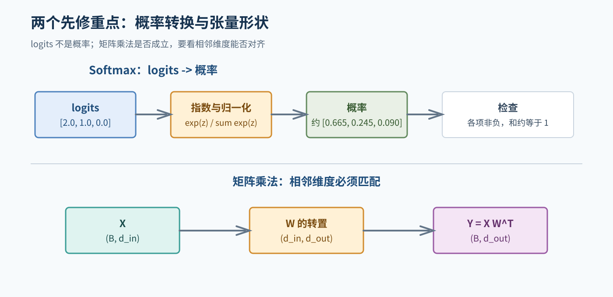
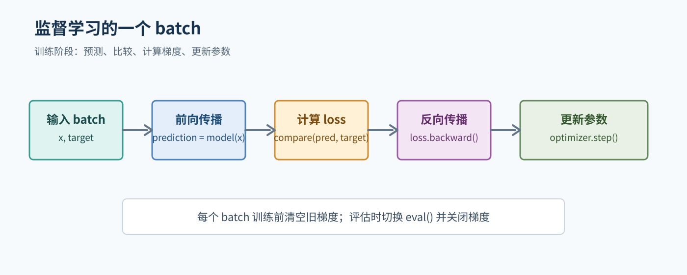
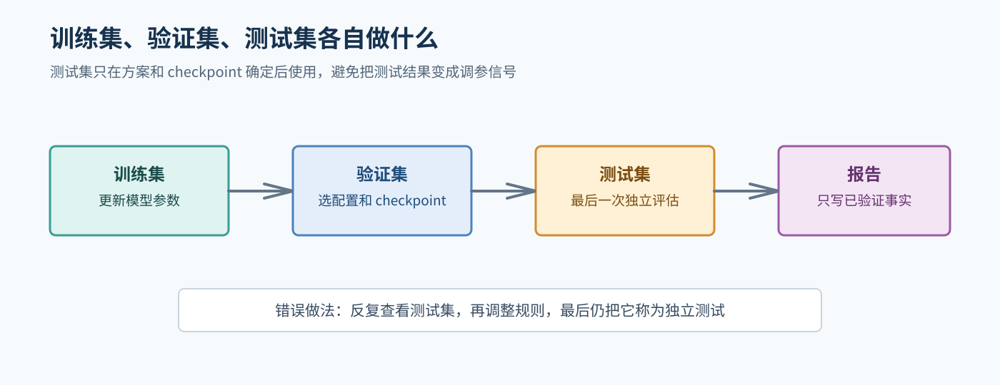
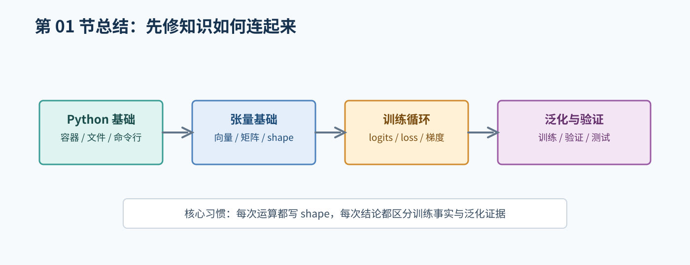

# 01. Python、数学与机器学习先修

本章只补充阅读 NLP 教程和实验代码所必需的基础。目标不是把 Python 或数学完整学完，而是让你能读懂数据处理、张量运算和训练循环。

## 1. C、C++ 和 Python 的关键差异

你有 C 语言基础时，可以把 Python 理解为一种更强调对象和动态类型的高级语言，但不要把两者的语法直接混用。

| 主题 | C | Python |
| --- | --- | --- |
| 变量类型 | 通常声明时写出，如 `int n` | 运行时绑定，如 `n = 3` |
| 代码块 | 使用 `{}` | 使用缩进 |
| 语句结束 | 通常使用 `;` | 通常换行，不写 `;` |
| 数组/列表 | 固定类型和长度更常见 | `list` 可保存对象，长度可变 |
| 内存 | 常需要手动管理指针和内存 | 一般由解释器管理对象内存 |
| 函数 | 需先声明返回类型 | 使用 `def`，可返回多个对象 |
| 空值 | 常见 `NULL` | 常见 `None` |
| 相等判断 | `==` | `==`；`is` 通常用于判断是否为同一对象 |

一个 Python 函数：

```python
def average(values):
    if len(values) == 0:
        return None
    return sum(values) / len(values)
```

要点：`def` 定义函数，冒号开始代码块，缩进表示层级；Python 不需要声明 `values` 的类型。

常用容器：

```python
words = ["我", "喜欢", "NLP"]
label_to_id = {"O": 0, "B-PER": 1}
for word in words:
    print(word)
```

- `list` 用整数下标访问，如 `words[0]`。
- `dict` 通过键访问，如 `label_to_id["O"]`。
- `for` 遍历元素，不等同于 C 中必须手动维护下标的写法。

## 2. 文件和命令行

实验通常通过命令行运行。需要理解：

```bash
python -m package.train --config configs/smoke.yaml
```

`python` 启动解释器，`-m package.train` 运行一个模块，后面的内容是命令行参数。参数通常由配置对象读取，便于保存实验设置。

读取文本时要明确编码和数据格式：

```python
from pathlib import Path

text = Path("example.txt").read_text(encoding="utf-8")
```

JSON、CSV、JSONL 等格式应优先使用对应解析器，不要依靠字符串切割猜字段。读取数据后先打印一条样本，确认字段和类型。

## 3. 向量、矩阵和形状

### 3.1 向量

向量可以看成一列数字。例如：

```text
x = [2, 5, 1]
```

在 NLP 中，一个 token 的 embedding 可能就是一个几十或几百维的向量。

### 3.2 矩阵乘法

若 `W` 形状为 `(d_out, d_in)`，`x` 形状为 `(d_in,)`，则：

```text
y = W x
```

得到 `y.shape = (d_out,)`。神经网络中的线性层就是类似的变换加偏置：

```text
y = x W^T + b
```

批量输入时，如果 `X.shape = (B, d_in)`，则 `Y.shape = (B, d_out)`。

### 3.3 广播和转置

张量运算中常见两个问题：

- **转置**：交换维度，例如矩阵 `(2, 3)` 变成 `(3, 2)`。
- **广播**：较小形状的张量按规则扩展后参与计算，例如每个 batch 加同一个偏置向量。

不要凭感觉判断形状。每次遇到 `matmul`、`view`、`reshape`、`transpose` 或 `permute`，都写出变换前后的形状。

## 4. 概率和 softmax

模型最后常输出一组任意实数，称为 logits。例如：

```text
[2.0, 1.0, 0.0]
```

softmax 把它们转换成和为 1 的概率：

```text
softmax(z_i) = exp(z_i) / sum_j exp(z_j)
```

分数差异越大，概率分布通常越集中。实际库会使用数值稳定实现，避免 `exp` 溢出。生成模型中的 temperature 会改变分布的尖锐程度，但不能把它理解成“让模型更聪明”的开关。



图 2：softmax 把分数转换为概率，矩阵乘法则要求相邻维度匹配。

## 5. 神经网络训练循环

最基本的监督训练循环如下：

```text
for each batch:
    prediction = model(input)
    loss = compare(prediction, target)
    optimizer.zero_grad()
    loss.backward()
    optimizer.step()
```



图 1：训练循环中每个步骤的先后关系。评估时不执行反向传播和参数更新。

各步骤含义：

1. **前向传播**：模型根据输入计算预测。
2. **损失**：比较预测和目标。
3. **清空梯度**：避免当前 batch 和上一个 batch 的梯度意外累加。
4. **反向传播**：根据链式法则计算参数梯度。
5. **更新参数**：优化器按照学习率等规则改变参数。

训练和评估状态不同：训练时可能启用 dropout；评估时通常使用 `eval()` 并关闭梯度。否则验证结果可能不稳定，也可能浪费显存。

## 6. 常见损失

### 6.1 交叉熵

对于多分类任务，交叉熵会鼓励真实类别获得更高概率。NER 每个有效 token 都可以产生一个分类损失；机器翻译和语言模型则在每个目标位置预测下一个 token。

### 6.2 忽略位置

padding 或特殊 token 通常没有有效监督标签。实现时可以使用 `ignore_index`，让这些位置不参与损失。必须确认标签中的忽略值和 loss 配置一致。

## 7. 过拟合和泛化

- **过拟合**：模型记住训练数据，但在新数据上表现差。
- **泛化**：模型对没有见过的数据仍能工作。
- **训练集**：更新参数。
- **验证集**：选择配置或 checkpoint。
- **测试集**：最后一次独立评估。

只用训练集上的高分不能证明模型有泛化能力。也不能反复查看测试集后调整系统，再把测试结果称为独立结果。



图 3：训练集更新参数，验证集选择方案，测试集只做最后的独立评估。

## 8. 本章自测

1. Python 的 `list` 和 `dict` 分别适合怎样访问数据？
2. `X.shape = (4, 10, 768)` 中三个维度分别可能是什么？
3. logits 和概率有什么区别？
4. 为什么每个 batch 训练前通常要清空梯度？
5. 为什么要把训练集、验证集和测试集分开？

## 9. 建议的小作业

使用纯 Python 写一个极小的 softmax 函数，并对 `[2, 1, 0]` 输出结果求和检查是否接近 1。然后使用 PyTorch 创建形状为 `(2, 3)` 的输入和形状为 `(3, 4)` 的权重，写出矩阵乘法结果形状。这个练习的重点是形状，不是模型效果。

## 本章总结框图



图：本章把 Python、张量、训练循环和泛化验证连接起来。
