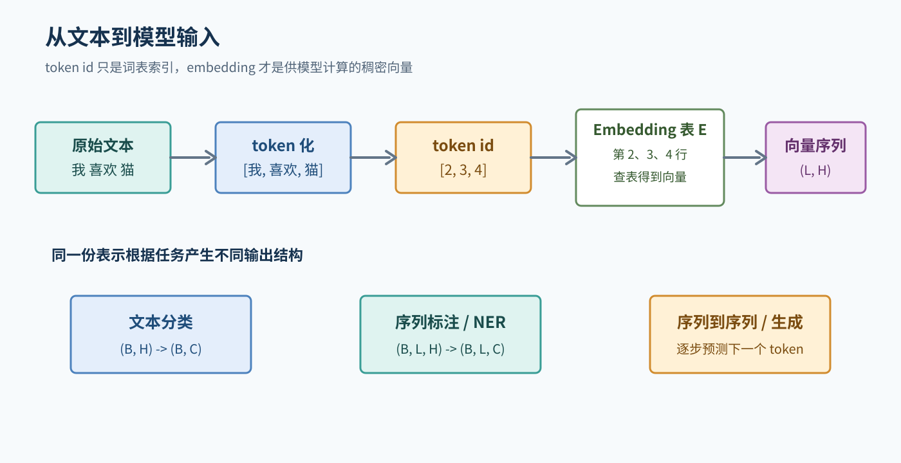
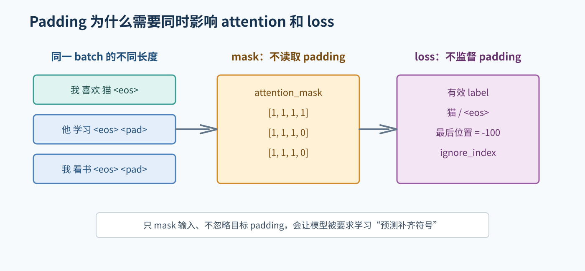
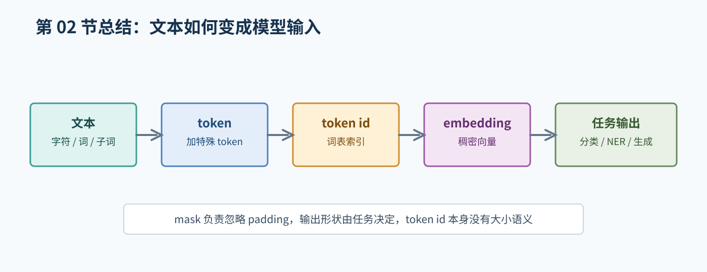

# 02. NLP 问题与文本表示

## 1. 文本为什么需要表示

神经网络接收数字，而文本由字符、词和句子组成。一个最基本的处理流程是：

```text
原始文本 -> 清洗/规范化 -> token 化 -> token id -> 向量
```



图 1：token id 是词表索引，embedding 查表后才得到供模型计算的向量；不同任务的输出结构也不同。

例如，假设词表为：

```text
{"<pad>": 0, "<unk>": 1, "我": 2, "喜欢": 3, "猫": 4}
```

句子“我喜欢猫”可以得到：

```text
tokens: ["我", "喜欢", "猫"]
ids:    [2, 3, 4]
```

这些整数只是词表中的索引。`4` 不表示“猫”比 `2` 大，也不表示猫比我更重要。

## 2. 词、字符、子词和 token

中文可以按字切分，也可以使用词或子词；英文一个单词也可能被拆成多个子词。模型真正看到的是 tokenizer 产生的 token，而不是我们肉眼认为的“词”。

选择切分方式会影响：

- 词表大小和未知词数量。
- 一句话的 token 长度。
- 训练和推理的显存与速度。
- NER 标签如何和 token 对齐。

因此报告不能只写“使用了分词”，还要写 tokenizer 的具体名称或词表构建方法、特殊 token 和最大长度。

## 3. 特殊 token、padding 和 mask

常见特殊 token：

| token | 作用 |
| --- | --- |
| `<pad>` | 把不同长度的样本补齐到同一长度 |
| `<unk>` | 词表中没有的 token |
| `<bos>` | 目标序列的开始 |
| `<eos>` | 目标序列的结束 |
| `[CLS]`、`[SEP]` | BERT 等模型中的特殊 token（具体用法依模型而定） |

同一 batch 的句子长度可能不同：

```text
[我, 喜欢, 猫, <eos>]
[他, 学习, <eos>, <pad>]
```

`attention_mask` 通常控制模型是否把某个位置作为可见的输入；`causal mask` 只用于自回归注意力，阻止读取未来 token；labels 中的 `ignore_index` 则控制哪些位置不参与 loss。三者不是同一个 mask。具体框架对布尔值的含义可能不同，必须查所用 API。



图 2：padding 既不应被注意力读取，也不应被当成有效目标计算 loss。

## 4. One-hot 和 embedding

### 4.1 One-hot

如果词表只有五个词，每个词可以表示为五维向量，其中一个位置是 1，其余为 0：

```text
cat -> [1, 0, 0, 0, 0]
dog -> [0, 1, 0, 0, 0]
```

这种表示简单，但有三个问题：维度随词表增大、向量稀疏、不同词之间没有相似性信息。

### 4.2 Embedding

Embedding 是一个可训练矩阵：

```text
E.shape = (vocab_size, embedding_dim)
```

token id 作为行号查表，得到一个稠密向量。模型在训练中更新这个矩阵，使表示有机会编码上下文中有用的规律。

要注意：embedding 的每个维度通常没有固定的人类解释；“向量距离近”也不自动等于两个词在所有语境中都同义。

## 5. 从文本任务看输出结构

### 5.1 文本分类

输入一段文本，输出一个类别：

```text
hidden: (B, H)
logits: (B, C)
```

例如情感分类。`C` 是类别数。

### 5.2 序列标注

输入一串 token，每个位置输出一个标签：

```text
hidden: (B, L, H)
logits: (B, L, C)
```

NER 属于序列标注。它不仅要判断类别，还要保持实体边界。

### 5.3 序列到序列

输入源序列，生成目标序列，输入和输出长度可以不同。机器翻译属于这种任务。

### 5.4 自回归生成

给定前缀，预测下一个 token：

```text
P(x_t | x_1, x_2, ..., x_{t-1})
```

模型生成一个 token 后，把它接回前缀，继续预测下一步。数学题大模型实验属于这种任务。

## 6. 统计语言模型的直觉

语言模型的核心问题是估计一串 token 的概率。根据链式法则：

```text
P(x_1, ..., x_T) = product_t P(x_t | x_1, ..., x_{t-1})
```

实际计算通常使用对数概率，避免很多小概率连乘造成下溢。训练时最大化正确下一个 token 的概率，等价于最小化负对数似然或交叉熵。

## 7. 数据预处理的边界

预处理不是越多越好。常见步骤包括：

- 统一明显的编码和换行问题。
- 删除明确无意义的空记录。
- 根据任务需要处理大小写、空白和标点。
- 训练时若需要从数据拟合词表、IDF 等统计量，只能使用训练集；验证集和测试集应用已经确定的规则。使用预训练模型时，应沿用其 tokenizer 和词表，不要再用当前任务的测试集建立词表。
- 保留原始数据到不可提交的位置，方便追溯。

不要没有记录地删除数字、标点或特殊符号。对数学题和实体识别来说，数字、大小写、标点可能是任务信息。

## 8. 本章自测

1. 为什么 token id 的数值大小没有语义？
2. `padding` 和 `unknown token` 分别解决什么问题？
3. 文本分类、NER 和生成任务的输出形状有什么区别？
4. 为什么 NER 的 tokenizer 改变后可能需要重新处理标签？
5. 如果测试集参与词表构建，这是否可能造成信息泄漏？为什么？

## 9. 建议的小作业

取一句你熟悉的中文句子，分别设计“按字切分”和“按词切分”两种结果。比较它们的序列长度、可能的实体标签数量和未知词风险。不要判断哪种一定更好，写出需要用实验验证的因素。

## 本章总结框图



图：本章总结文本从 token 化、id、embedding 到不同任务输出的转换过程。
