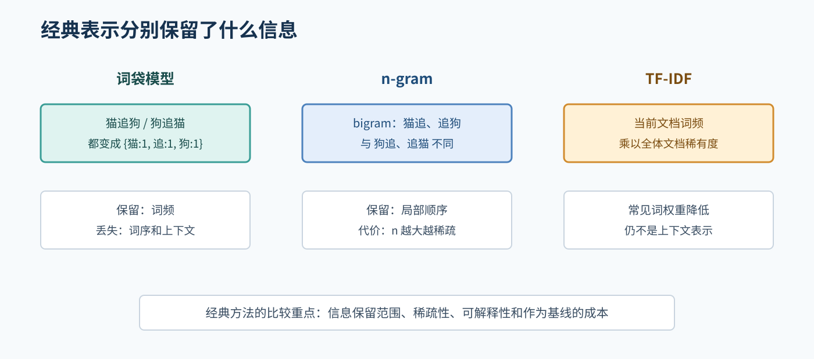

# 03. 经典 NLP 方法

在 Transformer 和大语言模型之前，NLP 已经有一套很丰富的方法。理解这些方法有助于你知道现代模型到底改进了什么，也能帮助你为实验选择简单、可解释的基线。

## 1. 词袋模型和 n-gram

### 1.1 词袋模型

词袋模型只统计文本中出现了哪些词以及出现次数，不保留词序。例如：

```text
“猫追狗” -> {猫: 1, 追: 1, 狗: 1}
“狗追猫” -> {猫: 1, 追: 1, 狗: 1}
```

它简单、速度快，但不能表达顺序和上下文关系。

### 1.2 n-gram

n-gram 是**连续的 n 个 token**组成的片段。token 可以是字、词或子词；窗口每次向右移动一个 token。例如：

```text
tokens = ["猫", "追", "狗"]  # 本例假定按字切分
unigram: ["猫"], ["追"], ["狗"]
bigram:  ["猫", "追"], ["追", "狗"]
trigram: ["猫", "追", "狗"]
```

n-gram 常见有两种用法：

- **n-gram 特征**：提取并统计这些片段，作为分类器的输入。词袋模型无法区分“猫追狗”和“狗追猫”，但 bigram 能得到不同的片段，如 `["猫 追", "追 狗"]` 和 `["狗 追", "追 猫"]`，因此保留了一部分局部顺序。
- **n-gram 语言模型**：根据片段的出现次数，估计下一个 token 的概率。

以 bigram 语言模型为例，它只根据前一个 token 预测当前 token。对语料：

```text
<BOS> 我 爱 猫 <EOS>
<BOS> 我 喜欢 狗 <EOS>
```

概率可以用计数估计：

```text
P(w_t | w_{t-1}) = count(w_{t-1}, w_t) / count(w_{t-1})
P(爱 | 我) = 1 / 2
P(喜欢 | 我) = 1 / 2
```

trigram 则根据前两个 token 预测下一个 token，例如 `P(猫 | 我, 爱) = 1`。`<BOS>` 和 `<EOS>` 分别表示句首和句尾，帮助模型处理句子的开始和结束。

如果训练语料中没有某个 bigram，未平滑的计数估计会得到零概率。例如“狗”在语料词表中，但没有出现在“爱”之后，则 `P(狗 | 爱) = 0`。若某个上下文从未出现，分母也为零，需要回退等处理。实际 n-gram 语言模型需要平滑、回退或插值。`n` 越大，看到的局部上下文越多，但片段组合越多、数据越稀疏；所以 n-gram 能表达的主要是局部顺序，不能很好处理长距离关系和语义。

## 2. TF-IDF

TF-IDF 用来衡量词对一篇文档的重要程度。IDF 通常依据训练语料中包含该词的文档数计算；具体公式会因实现而异。词表和 IDF 必须只在训练集上拟合，再原样应用到验证集和测试集。

- TF：词在当前文档中的频率。
- IDF：词在整个文档集合中越少见，区分度通常越高。

直觉上，“的”“是”等所有文档都常见的词区分度低；某个文档中特别常见、其他文档少见的词可能更有区分力。

TF-IDF 仍然是稀疏的表面特征，不能直接理解同义表达，但在小数据分类中可能是很有用的基线。和复杂模型比较时，基线能帮助判断模型提升是否真的来自方法，而不是数据处理差异。



图 2：词袋保留词频，n-gram 增加局部顺序，TF-IDF 调整词的区分权重。

## 3. 朴素贝叶斯和线性分类器

朴素贝叶斯假设给定类别后各特征条件独立。这个假设通常不完全成立，但在文本分类中实现简单、训练快。逻辑回归和线性 SVM 等线性模型可以直接对 TF-IDF 特征学习分类边界。

一个合理的分类基线应固定：

- 数据划分。
- 文本预处理。
- 特征提取方法。
- 正则化和超参数。
- 评估指标。

否则模型差异可能被实验设置差异掩盖。

## 4. 词向量的分布式假设

分布式表示的核心直觉是：出现在相似上下文中的词，可能具有相似表示。Word2Vec 的 skip-gram 和 CBOW 是经典例子；GloVe 也利用词共现统计学习向量。

这些静态词向量对一个词只有一个向量，因此难以直接表达一词多义。例如“苹果”在水果语境和公司语境中的表示不会自动分开。后来的上下文表示模型让同一个 token 根据句子上下文产生不同向量。

## 5. 传统序列标注

NER 早期常见方法包括：

- Hidden Markov Model, HMM。
- Maximum Entropy Markov Model, MEMM。
- Conditional Random Field, CRF。

传统序列标注方法的建模假设并不相同：HMM 是生成式模型，常见形式假设标签按一阶马尔可夫链变化，并假设观测在给定标签后条件独立；MEMM 和 CRF 则直接建模给定输入时的标签序列。CRF 可以学习相邻标签的兼容分数，但不自动强制 BIO 转移合法，除非另加约束解码。传统 MEMM/CRF 系统常需要人工设计特征；这不应笼统归到所有 HMM 上。

现代 BERT + token classification 可以减少手工特征，但并不意味着标签约束和数据对齐问题消失了。某些系统仍会在 BERT 表示后使用 CRF；是否使用要由实际方案和验证结果决定。

## 6. 基线和经典方法为什么仍然值得学

在实验中，**基线**是一个简单、明确、可重复的参照方法，用来判断复杂模型是否真的带来改进。**多数类基线**统计训练集里出现次数最多的类别，然后对每条输入都预测这个类别；它不需要学习文本特征，但仍应在同一个测试集和同一个指标上评估。TF-IDF + 线性分类器则把每篇文档转换为 TF-IDF 向量，再根据训练标签学习分类边界。多数类和 TF-IDF + 线性分类器是**文档分类**基线，不能直接与机器翻译 BLEU、NER 实体级 F1 或数学生成 Accuracy 比较。基线必须针对相同任务、数据划分和指标设计。这样，练习中的“输入、预测规则和评价指标”分别可以写成：文档及其特征、从训练数据得到的预测规则、预先选定的分类指标。

经典方法仍然值得学：

1. 它们提供可解释的低成本基线。
2. 小数据或资源受限时未必很差。
3. 它们帮助定位问题：如果 TF-IDF 都无法工作，复杂模型可能也有数据问题。
4. 它们让你理解 embedding、上下文和预训练分别解决了什么。

## 7. 本章自测

1. 词袋模型为什么无法区分“猫追狗”和“狗追猫”？
2. TF-IDF 为什么会降低常见词的区分作用？
3. 朴素贝叶斯的“朴素”假设是什么？
4. 静态词向量处理一词多义时有什么局限？
5. CRF 在序列标注中可以表达哪类信息？
6. 对 token 序列 `[我, 喜欢, 猫]`，它的 bigram 是什么？bigram 特征和 bigram 语言模型有什么区别？
7. n-gram 语言模型为什么会出现零概率？平滑试图解决什么问题？

## 8. 建议的小作业

为一个简单的文本分类任务设计两个基线：多数类基线和 TF-IDF + 线性分类器。写出它们的输入、训练目标和评价指标。即使本仓库的三项作业不要求你实现这两个基线，也要能说明它们在实验设计中的价值。

## 本章总结框图


图：词袋、n-gram、TF-IDF 是可组合的文档特征方法；分类器使用这些特征完成文档分类。词向量是另一类表示，HMM/CRF 等方法用于序列标注；这些方法不是一条必须依次经过的流水线。
