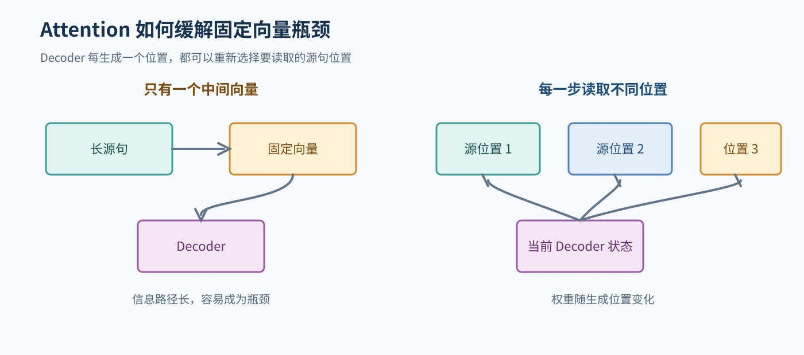
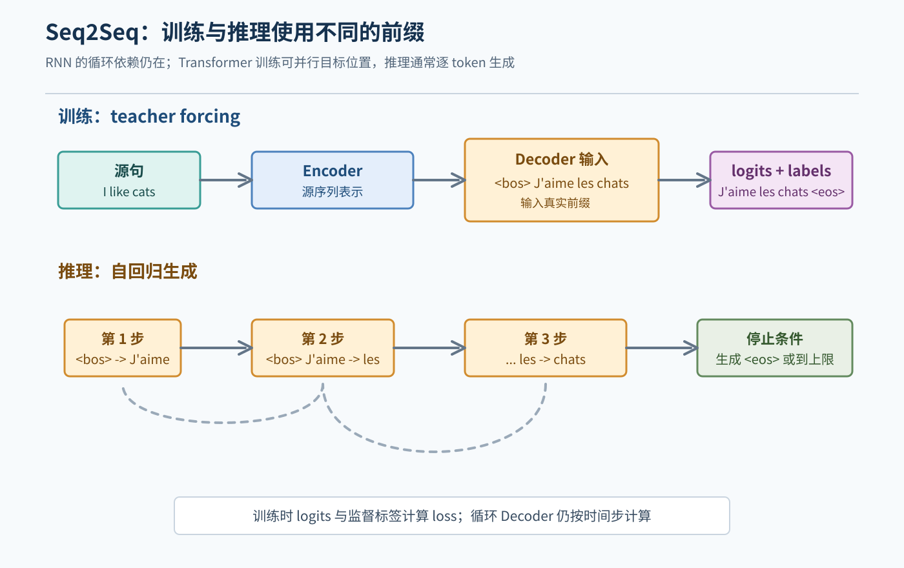
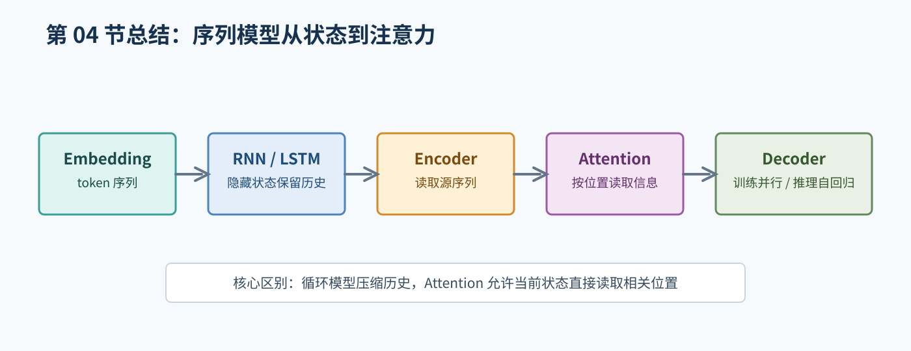

# 04. 神经网络与序列模型

## 1. 从前馈网络到序列模型

普通前馈网络处理一个固定大小的输入。文本序列长度可变，而且词的含义依赖上下文，因此需要能处理序列的结构。

最简单的神经网络文本流程是：

```text
token id -> embedding -> 聚合或序列模型 -> 任务分类器
```

如果把所有 token embedding 求平均，可以得到固定长度向量，但会丢失顺序和细粒度上下文。

## 2. RNN 的核心思想

RNN 在第 `t` 个位置使用当前输入 `x_t` 和上一步状态 `h_{t-1}`：

```text
h_t = f(W_x x_t + W_h h_{t-1} + b)
```

`h_t` 既包含当前输入信息，也尝试保留前文信息。最后可以使用最后一个状态做分类，也可以使用所有状态做序列标注。

RNN 的优点是结构直观、可以处理变长序列；问题是时间步之间依赖，难以完全并行，而且长序列中可能出现梯度消失或难以保留远距离信息。

## 3. LSTM 和 GRU

LSTM 用门控制信息的写入、保留和输出，帮助处理更长依赖。GRU 使用更少的门，结构更简化。它们改善了普通 RNN 的训练问题，但仍然按时间步处理，长序列并行效率有限。

本章不要求你手写 LSTM 的全部门公式。重点是理解：循环模型把历史压缩到状态中，状态容量和信息传递路径会影响长距离依赖。

## 4. Seq2Seq

序列到序列模型用一个 Encoder 读取源序列，再用 Decoder 生成目标序列：

```text
源句 -> Encoder -> 中间表示 -> Decoder -> 目标句
```

这解决了输入和输出长度可以不同的问题，因此适合机器翻译、摘要和对话等任务。

最早的 Seq2Seq 常把源句压缩为一个固定向量。句子较长时，单一向量可能成为瓶颈。Attention 允许 Decoder 在生成每个词时查看源序列的不同位置。

## 5. Attention 的直觉

Decoder 当前状态可以作为 Query，源序列各位置的表示作为 Key 和 Value。模型计算当前目标位置应该从源句各位置读取多少信息，再加权汇总。

例如翻译一个专有名词时，当前目标位置可能更关注源句中对应的名称；翻译一个动词时，可能关注主语和上下文。这里的“关注”是模型学习到的权重，不应简单等同于人类解释。



图 2：Decoder 在不同生成位置可以读取源句的不同位置，而不是只能依赖一个固定向量。

## 6. Teacher forcing

训练时，Decoder 可以使用真实目标前缀：

```text
目标序列: <bos> 我 喜欢 猫 <eos>
输入:      <bos> 我 喜欢 猫
标签:          我 喜欢 猫 <eos>
```

模型在每个位置预测下一个 token。这样可以并行计算多个位置，但训练时看到的前缀通常比推理时更可靠，导致训练和推理存在差异。

## 7. 训练和推理

训练时有真实标签，可以一次处理目标序列；推理时没有真实目标，只能把上一步自己的预测接回输入：

```text
<bos>
<bos> 我
<bos> 我 喜欢
<bos> 我 喜欢 猫
```



图 1：训练时可以使用真实目标前缀，推理时要把模型自己的预测接回输入。

推理通常在生成 `<eos>` 或达到最大长度时停止。常见解码方法包括 greedy decoding 和 beam search。它们会改变结果，必须在实验记录中说明。

## 8. 本章和作业的关系

- 机器翻译需要理解 Seq2Seq、Encoder、Decoder、teacher forcing 和生成。
- BERT 使用 Transformer Encoder，但不是传统 RNN Seq2Seq Decoder。
- GPT 类模型使用自回归 Decoder 风格结构，按 token 生成数学答案。

## 9. 本章自测

1. RNN 的隐藏状态试图保存什么信息？
2. Seq2Seq 为什么适合输入输出长度不同的任务？
3. Attention 解决了固定中间向量的什么瓶颈？
4. Teacher forcing 中为什么输入和标签要错开一位？
5. 训练和推理时 Decoder 得到的前缀有什么不同？

## 10. 建议的小作业

用纸画出一个长度为 4 的 Seq2Seq 翻译流程，标出 Encoder 输入、Decoder 输入、Decoder 标签和生成停止条件。再在图旁边写出训练时可并行、推理时通常自回归的原因。

## 本章总结框图



图：本章从 embedding、循环状态和 Encoder 走到 Attention 与 Decoder。
