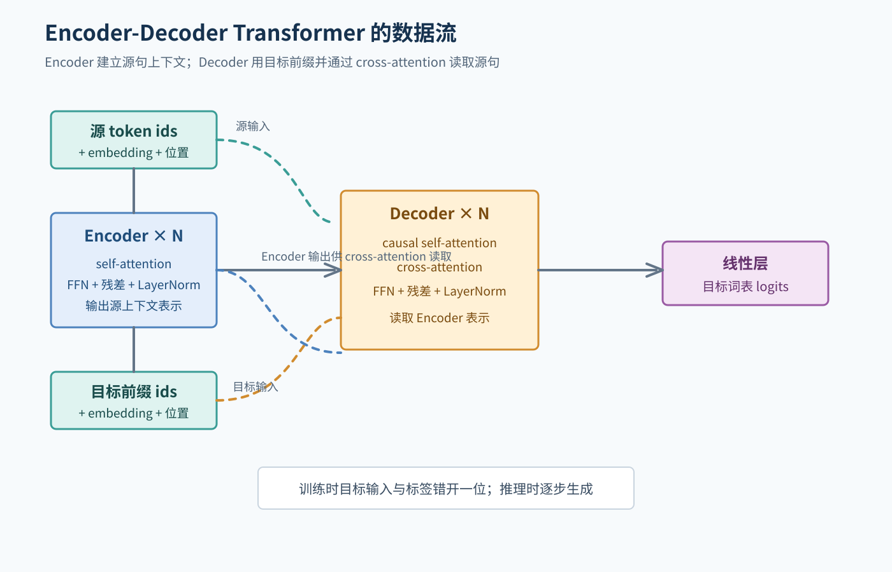
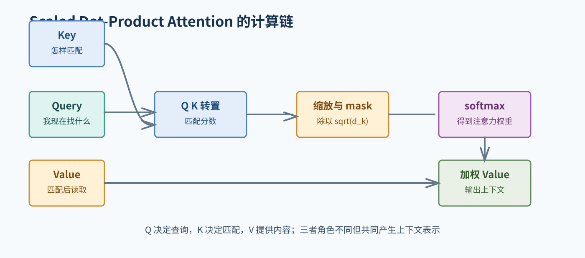
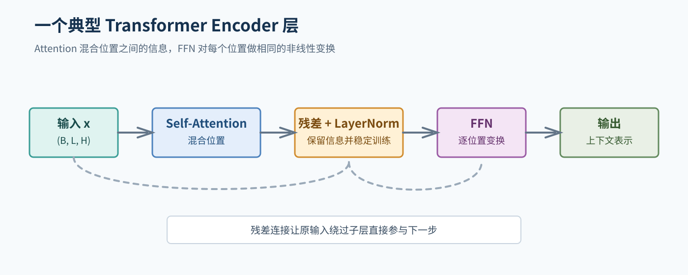
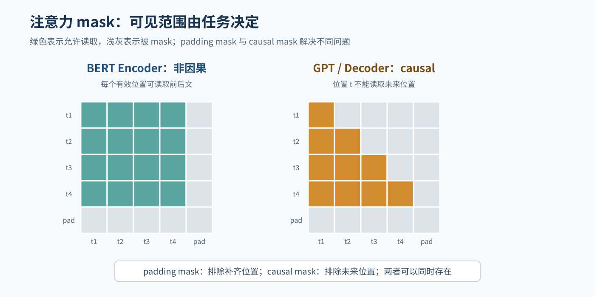
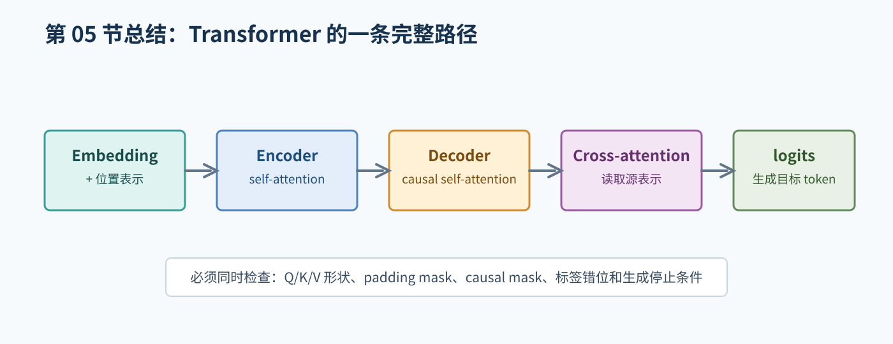

# 05. Attention 与 Transformer

## 1. Transformer 为什么重要

Transformer 使用 Attention 建立序列中不同位置之间的联系，不依赖 RNN 的逐时间步循环，因此训练阶段更容易并行。它仍然需要处理顺序信息，所以要加入位置表示。

一个 Encoder-Decoder Transformer 的整体数据流是：

```text
源 token ids
  -> 源 embedding + 位置表示
  -> Encoder 多层
  -> 源序列上下文表示

目标前缀 token ids
  -> 目标 embedding + 位置表示
  -> Decoder 多层，并读取 Encoder 表示
  -> 线性层
  -> 目标词表 logits
```



图 1：Encoder 提供源序列上下文，Decoder 通过 self-attention 和 cross-attention 生成目标 logits。

## 2. Scaled Dot-Product Attention

给定 Query、Key、Value：

```text
Attention(Q, K, V) = softmax(Q K^T / sqrt(d_k) + mask) V
```

可以按三步理解：

1. `Q K^T` 计算 Query 与各 Key 的匹配分数。
2. 除以 `sqrt(d_k)` 控制数值尺度，再用 mask 排除不允许的位置。
3. softmax 变成权重，对 Value 加权求和。

`Q` 表示“我现在要找什么”，`K` 表示“每个位置能被怎样匹配”，`V` 表示“匹配后要读取的内容”。这是帮助理解的直觉，不是每个维度的固定语义。



图 2：注意力先计算匹配分数，再经过缩放、mask 和 softmax，最后加权读取 Value。

## 3. Self-Attention 和 Cross-Attention

- **Self-Attention**：Q、K、V 来自同一个序列。Encoder 用它理解源句内部关系；Decoder 的目标 self-attention 用它理解已经出现的目标前缀。
- **Cross-Attention**：Q 来自 Decoder，K 和 V 来自 Encoder。它让 Decoder 根据当前目标状态查看源句表示。

Encoder 只有 self-attention；典型的 Encoder-Decoder Decoder 同时有目标 self-attention 和 cross-attention。

## 4. Multi-Head Attention

多头注意力把隐藏表示投影到多个子空间，每个 head 独立计算注意力，最后拼接并投影：

```text
head_i = Attention(X W_Q_i, X W_K_i, X W_V_i)
MHA(X) = Concat(head_1, ..., head_h) W_O
```

常见形状变化：

```text
X:       (B, L, H)
分头后:  (B, heads, L, head_dim)
输出后:  (B, L, H)
```

实现时最容易错的是维度顺序、mask 的广播和合并 heads 的位置。

### 4.1 Attention 的张量形状

为了完成后面的形状练习，先固定使用 batch-first 的记号。自注意力分头后：

```text
Q, K, V:              (B, heads, L, head_dim)
Q K^T 的注意力分数:   (B, heads, L, L)
加权求和后的输出:     (B, heads, L, head_dim)
```

如果 Query 和 Key/Value 来自长度不同的序列，交叉注意力的形状是：

```text
Q:                    (B, heads, target_length, head_dim)
K, V:                 (B, heads, source_length, head_dim)
注意力分数:           (B, heads, target_length, source_length)
```

因此，mask 至少要能广播到对应的注意力分数形状。自注意力的 causal mask 常写成 `(target_length, target_length)`，再广播到 batch 和 head 维度；也可以显式写成 `(B, 1, target_length, target_length)`。具体写法以所用实现为准。

## 5. Position Representation

Self-attention 本身可以同时读取所有位置，但只看 token 集合并不能知道顺序。因此需要位置编码或位置 embedding：

```text
输入表示 = token embedding + position representation
```

原始 Transformer 使用正弦/余弦位置编码；其他模型可能使用可学习位置 embedding 或相对位置方法。不要把不同模型的位置方法混写。

## 6. Encoder 层

典型 Encoder layer 包含：

```text
x -> self-attention -> 残差连接 + LayerNorm
  -> FFN            -> 残差连接 + LayerNorm
```

FFN 对每个位置独立应用相同的两层网络：

```text
FFN(x) = activation(x W_1 + b_1) W_2 + b_2
```

Attention 负责混合不同位置的信息；FFN 提供逐位置的非线性变换；残差连接帮助信息和梯度传播；LayerNorm 有助于训练稳定。具体的 pre-norm 或 post-norm 形式需要以实现为准。



图 3：Encoder 层由 self-attention、残差与 LayerNorm、FFN 等部分组成。

## 7. Decoder 层和两个重要 mask

Decoder 的目标 self-attention 需要 causal mask：位置 `t` 不能读取 `t+1` 及之后的真实目标词，否则训练时会偷看答案。

还要处理 padding：

- padding mask：不读取补齐位置。
- causal mask：不读取未来位置。

二者作用不同。机器翻译实现中，源 padding、目标 padding 和目标 causal mask 可能在不同 attention 调用中分别使用。



图 2：padding mask 排除补齐位置，causal mask 排除未来位置；它们不是同一个 mask。

## 8. 训练、损失和生成

对于目标序列：

```text
<bos> 我 喜欢 猫 <eos>
```

Decoder 输入和标签错开：

```text
输入: <bos> 我 喜欢 猫
标签: 我     喜欢 猫 <eos>
```

模型输出每个位置对整个目标词表的 logits，交叉熵通常忽略目标 padding。推理时从 `<bos>` 开始，逐步生成 token，直到 `<eos>` 或达到最大长度。

## 9. 常见错误

- 忘记 causal mask，训练指标虚高，推理质量异常。
- Decoder 输入和标签没有错位。
- 目标 padding 参与 loss。
- Multi-Head reshape 后没有确认维度顺序。
- 位置表示长度小于实际序列长度。
- 推理时没有 `eval()` 或没有关闭梯度。
- 训练和评估使用了不同的 tokenizer 或特殊 token id。

## 10. 本章自测

1. Q、K、V 在 Attention 中分别起什么作用？
2. Cross-Attention 为什么需要来自两个序列的表示？
3. causal mask 和 padding mask 的区别是什么？
4. 为什么 Transformer 需要位置表示？
5. 训练可以并行处理目标位置，推理为什么通常要逐步生成？

## 11. 建议的小作业

先不写完整 Transformer，只实现一个小规模 Attention 的形状检查：设 `B=2`、`heads=4`、`L=5`、`head_dim=8`，写出 Q、K、V 和注意力矩阵的形状。然后说明 causal mask 的形状至少需要能广播到哪一组维度。

## 进一步阅读

- Vaswani et al., [Attention Is All You Need](https://arxiv.org/abs/1706.03762)。
- Harvard NLP, [The Annotated Transformer](https://nlp.seas.harvard.edu/annotated-transformer/)。
- PyTorch [MultiheadAttention 文档](https://pytorch.org/docs/stable/generated/torch.nn.MultiheadAttention.html)。

## 本章总结框图



图：本章总结 Transformer 从位置表示、Encoder、Decoder 到 logits 的计算路径及关键检查点。
