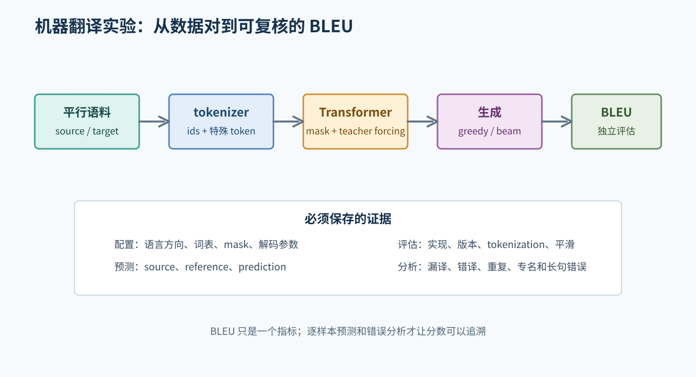
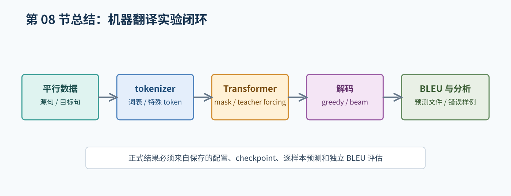

# 08. 机器翻译实验

本仓库的起始方案已在 [机器翻译 README](../machine_translation/README.md) 和配置中固定：使用 OPUS Books 英译法数据、SentencePiece 共享子词词表和 PyTorch Encoder-Decoder Transformer。默认固定 revision 并取 20,000 对样本划分；正式训练和测试评估尚未运行，不能把配置写成已验证结果。数据授权仍需按来源确认。

## 1. 先定义问题

机器翻译是序列到序列任务：给定源语言句子，生成目标语言句子。

以配置为准记录源/目标语言、数据 revision、划分、tokenizer/词表和特殊 token id。当前仓库使用英语到法语、共享 SentencePiece Unigram 词表，PAD=0、UNK=1、BOS=2、EOS=3；数据版本、许可证说明和模型超参数见专项 README 与配置，未经实际核验的授权事项标记为待确认。

## 2. 数据流

源句和目标句分别经 tokenizer 得到 `source_ids` 与完整 `target_ids`。训练与推理是不同路径：

```text
训练：target_ids (B,T) -> decoder_input=target_ids[:, :-1] (B,T-1)
                        -> logits (B,T-1,V) -> labels=target_ids[:, 1:] (B,T-1) -> loss
推理：<bos> -> Decoder -> 预测 token -> 接回前缀 -> ... -> <eos> 或最大长度
```

Encoder self-attention 屏蔽源 padding；Decoder self-attention 使用目标 padding 与 causal mask；cross-attention 屏蔽源 padding；交叉熵忽略目标 PAD。



图 1：训练用真实目标前缀计算 loss；推理用模型自己的前缀生成译文，评估需保存逐样本证据。

## 3. Transformer 组件

报告和代码说明至少覆盖：

- token embedding。
- 位置编码或位置 embedding。
- Encoder self-attention。
- Decoder causal self-attention。
- Decoder cross-attention。
- FFN、残差连接和 LayerNorm。
- 线性输出层和交叉熵。
- padding mask 与 causal mask。

你可以自己实现核心模块，也可以使用成熟库；但无论哪种方式，都必须能解释实际调用的组件和张量形状。

## 4. 训练前的最小验证

### 4.1 数据检查

打印几条：

- 原始源句和目标句。
- token 列表和 token id。
- padding 后长度。
- Decoder 输入和 label 的对应位置。
- mask 中可见和不可见的位置。

### 4.2 形状检查

设完整目标长度为 `T`（包含 `<bos>` 和 `<eos>`）：

```text
source_ids:  (B, source_length)
target_ids:  (B, T)
decoder_input = target_ids[:, :-1]: (B, T-1)
labels = target_ids[:, 1:]:         (B, T-1)
logits:      (B, T-1, target_vocab_size)
```

`logits` 的序列长度必须与 decoder input 和 labels 相同。

### 4.3 极小数据过拟合

只使用极少样本，确认模型可以降低训练损失并生成接近训练目标的输出。它不是正式结果，只用于排查：

- 标签错位。
- mask 方向错误。
- padding 没有忽略。
- tokenizer 或词表映射错误。
- 优化器没有更新参数。

## 5. 推理方式

- **Greedy decoding**：每一步选择最高概率 token，简单但不保证整句最优。
- **Beam search**：保留多个候选前缀，需要处理累计分数、长度偏置、结束条件和 beam size。

必须记录：解码方式、最大生成长度、长度惩罚、是否去掉特殊 token，以及模型使用的 checkpoint。

## 6. BLEU 和报告写法

BLEU 不是“翻译是否正确”的唯一答案。报告至少应说明：

- BLEU 实现和版本。
- 最大 n-gram 阶数。
- 参考译文数量。
- tokenization 和大小写处理。
- 平滑方法。
- 在哪个划分上计算。

不同配置下的 BLEU 不能直接比较。还要保存若干真实的源句、参考译文和模型译文，分析漏译、错译、重复、专有名词错误和长句错误等现象。

## 7. 评估文件建议

每条预测至少保存：样本 id、source、reference（字符串或多参考列表）、prediction 和评估划分。评估脚本应能只读取保存的预测文件独立重算 corpus BLEU；记录 tokenizer、大小写、平滑等完整配置。

## 8. 学习任务

1. 手工写出一条样本的 source ids、target decoder input 和 target labels。
2. 画出 Encoder、Decoder self-attention 和 cross-attention 的数据来源。
3. 为目标序列写出 causal mask 的可见区域。
4. 设计 10 条样本的过拟合测试。
5. 选择几条真实预测，按错误类型而不是按“感觉不好”分析。

## 9. 对应的专项材料

- [NLP、词元和词向量](../machine_translation/learn/01_nlp_and_embeddings.md)
- [Transformer 结构](../machine_translation/learn/02_transformer.md)
- [训练、推理与 BLEU](../machine_translation/learn/03_training_and_bleu.md)
- [机器翻译实验 README](../machine_translation/README.md)

## 10. 实验完成标准

在声称实验完成前，应有：数据和配置、训练日志、验证 checkpoint、测试预测文件、独立 BLEU 评估、若干错误样例，以及对数据和模型局限的说明。没有这些记录时，只能说“已完成代码阅读或 smoke test”，不能说已经得到正式翻译结果。

## 本章总结框图



图：本章总结机器翻译从平行数据到 tokenizer、Transformer、解码和 BLEU 分析的闭环。
