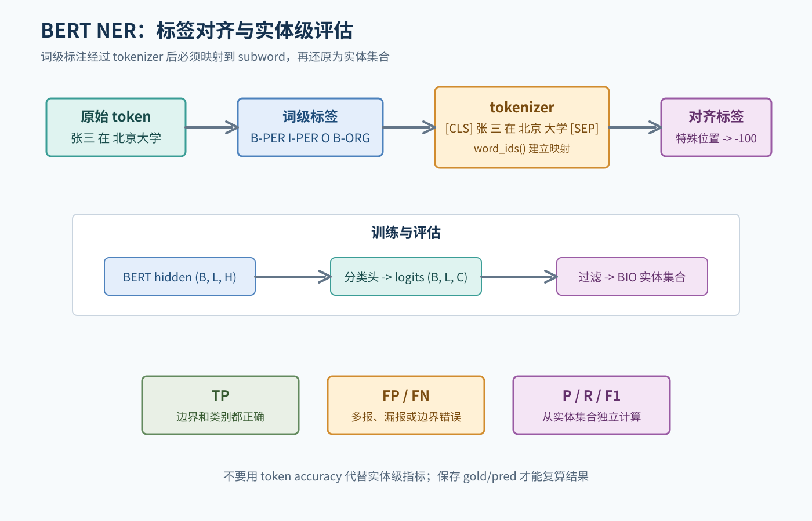
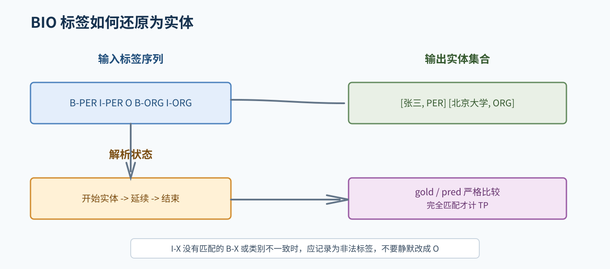
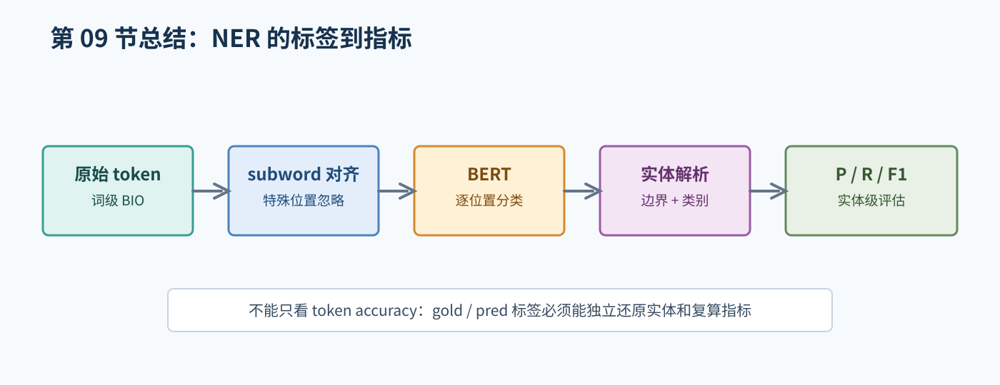

# 09. BERT 命名实体识别实验

## 1. 先定义 NER 输出

NER 是识别文本中的实体区间并判断类别。例如下面按字符切分的 toy 示例使用通用标签 `PER/ORG`，不是 CLUENER 的实际类别：

```text
字符：  张    三    在    北    京    大    学
标签：  B-PER I-PER O     B-ORG I-ORG I-ORG I-ORG
```

本仓库使用的 CLUENER 数据按实体在原文中的**闭区间字符位置**标注，先转换成字符级 IOB2，再进行 tokenizer/subword 对齐；类别名以数据集标签表为准。扁平 BIO 不能表达嵌套实体，需按数据审计记录处理方式。

## 2. 数据格式和标签表

开始训练前确认：

- 原始句子是按字符、词还是其他单位标注。
- 每条句子的 token 数和标签数是否相等。
- 实体类别名称和大小写。
- 标签是否满足 BIO/BIOES 约束。
- 训练、验证和测试如何划分，是否有重复句子。

建立显式映射，例如：

```text
O      -> 0
B-PER  -> 1
I-PER  -> 2
B-ORG  -> 3
I-ORG  -> 4
```

对话中真实预测的 `PER/ORG/LOC` 仅为通用示例，CLUENER 实际类别以数据集为准。标签映射必须与数据集一致；本仓库原始字符区间为闭区间，按字符转换为 IOB2 标签。

## 3. BERT + Token Classification

BERT 输出每个输入位置的隐藏向量：

```text
hidden_states: (B, L, H)
```

接一个线性分类头：

```text
logits: (B, L, C)
```

对每个有效位置取类别分数最大的标签。特殊 token、padding 和不参与损失的 subword 通常使用忽略标签，例如 `-100`；实际值要与 loss 配置一致。

## 4. Subword 对齐

原始标注按字符区间提供；tokenizer 可能把一个字符映射为一个或多个 subword。建议打印一条完整的对齐表：

| subword | 原始字符索引 | 原始标签 | 训练标签 |
| --- | ---: | --- | --- |
| `[CLS]` | - | - | `-100` |
| 张 | 0 | `B-PER` | `B-PER` |
| 三 | 1 | `I-PER` | `I-PER` |
| `[SEP]` | - | - | `-100` |

本仓库采用“每个原始字符的首个 subword 保留该字符标签，同一字符的后续 subword 设为 `-100`”的策略。若一个字符标签为 `I-X`，首个 subword 仍是 `I-X`，不能无条件改成 `B-X`。特殊 token 和 padding 不参与损失或实体评估，但仍可能作为上下文参与 BERT attention。其他对齐策略必须同步修改预测还原和评估。



图 1：本实验先从字符区间得到字符级标签，再映射至 subword；模型预测投影回字符坐标后按实体边界和类别评估。

## 5. 训练流程

```text
原始 token + 标签
  -> tokenizer
  -> word_ids() 或等价映射
  -> labels 对齐
  -> BERT
  -> 分类头
  -> 忽略特殊位置计算 loss
  -> 验证集选择 checkpoint
  -> 在有标签的评估划分上预测并解析实体
  -> 实体级指标
```

本仓库 CLUENER 的 `dev` 有标签，可用于 checkpoint 选择和实体级评估；当前 `test` 无标签，只能保存预测，不能计算 P/R/F1。

第一批数据至少打印：

```text
input_ids:      (B, L)
attention_mask: (B, L)
labels:         (B, L)
logits:         (B, L, C)
```

并人工查看真实标签和预测标签的长度是否对应。

## 6. 实体级 Precision、Recall、F1

不能只逐 token 比较。先把 BIO 标签解析成实体集合，例如：

```text
(B-PER, I-PER, O) -> 实体区间 [0, 2), 类别 PER
```

只有边界和类别都正确，才算一个 TP。实体按完全匹配的 `(start, end, type)` 比较，`O` 是有效的非实体标签，不计为实体；`-100` 才是需要从 loss/评估中忽略的位置。

```text
Precision = TP / (TP + FP)
Recall    = TP / (TP + FN)
F1        = 2 * Precision * Recall / (Precision + Recall)
```

报告要写清楚评估库、strict IOB2 规则和 micro/macro 聚合方式。`O` 是有效标签但不作为实体计分，不能只因它数量多就用 token accuracy 代替实体指标。

### 6.1 BIO 标签解析的基本规则

为了让实体解析器可以被检查，先约定 BIO 的最小解析规则：

- `B-X` 开始一个类别为 `X` 的新实体；如果前面已有实体，先结束前一个实体。
- `I-X` 只有在当前实体类别也是 `X` 时才继续该实体；没有对应的 `B-X`，或类别不一致，都属于非法标签。
- `O` 结束当前实体，不产生实体。
- 序列结束时，如果仍有一个实体，也要把它结束并保存。

特殊 token 和 padding 不应被解析成实体。遇到非法标签时，测试表应明确记录“报告异常”或其他预先约定的处理结果，不能默默把它当成 `O`，否则很难发现标注或对齐错误。



图 2：B-X 开始实体，I-X 延续同类实体，O 结束当前实体；非法转移应被记录。

## 7. 错误分析

从保存的真实预测中挑选样例，按现象分析：

- 边界多一个或少一个 token。
- 地点、机构、人名等类别混淆。
- 真实实体漏检。
- 普通词被错误识别为实体。
- 训练集中未出现的新实体。
- 长实体或 subword 切分导致的错误。

每条结论都应引用真实样本。不能只写“模型可能受到数据量影响”而不说明哪个样本体现了什么现象。

## 8. 评估文件与指标复算

`test.json` 当前没有 gold labels，因此本仓库的 P/R/F1 应基于有标签的 dev 或另行准备并说明的标注测试集。每条可复算记录应包含样本 id、原文字符、gold/pred 标签和投影回原始字符坐标的实体；无标签 test 预测不能用于填写实体指标。

## 9. 学习任务

1. 手工把三条 BIO 标签序列解析成实体区间。
2. 构造一个“边界错一位”的例子，说明为什么可能同时产生 FP 和 FN。
3. 对一条被拆成多个 subword 的样本制作对齐表。
4. 写一个极小的实体解析器测试表，包括单 token、相邻实体和非法标签。
5. 用极小样本检查 loss 能否下降。

## 10. 对应的专项材料

- [NER、BIO 标注和标签对齐](../bert_ner/learn/01_ner_and_labels.md)
- [BERT 和 Transformer Encoder](../bert_ner/learn/02_bert.md)
- [微调、预测与实体级指标](../bert_ner/learn/03_finetune_and_metrics.md)
- [BERT NER 实验 README](../bert_ner/README.md)

## 11. 实验完成标准

需要有数据与标签说明、tokenizer 和对齐测试、训练配置、checkpoint 选择规则、保存的 gold/pred 标签、独立实体级指标和真实错误样例。没有运行指标时，不应在报告中填写看起来完整但未经验证的数值。

## 本章总结框图



图：本章总结 NER 从 BIO 标签和 subword 对齐到实体解析与 P/R/F1 的路径。
