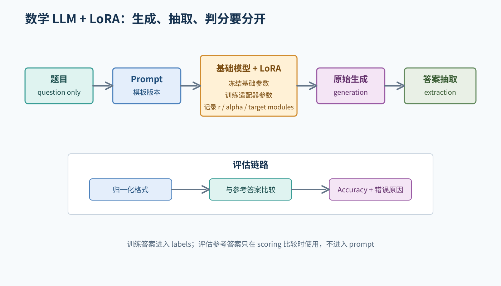
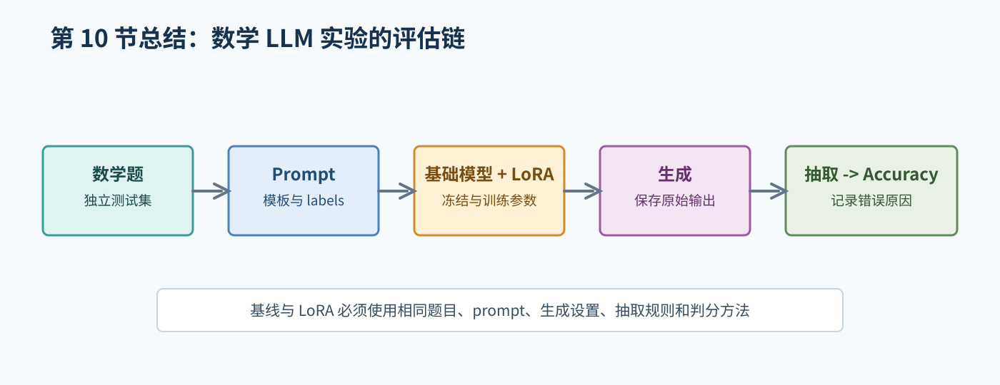

# 10. 数学 LLM 与 LoRA 实验

## 1. 先明确实验对象

数学大模型实验不是“输入题目，看看回答像不像”。它至少包含：

```text
题目数据 -> prompt 模板 -> tokenizer -> 自回归模型
        -> LoRA 适配器 -> 生成文本
        -> 答案抽取 -> 归一化 -> 判分
```



图 1：生成文本、答案抽取、格式归一化和最终判分应分别保存和测试。

开始前确认：

- 基础模型名称、版本和许可证。
- 数学数据集名称、来源、字段和许可证。
- 训练/验证/测试划分。
- prompt 模板和答案格式。
- LoRA 的 `r`、`alpha`、`dropout`、`target_modules`。
- 最大输入长度、最大生成长度和解码参数。
- 是否有未微调基础模型基线。

这些信息不能用“常见做法”替代实际实验记录。

## 2. 数据和泄漏检查

至少检查：

- 测试集是否真正独立。
- 训练和测试是否有相同题目或近似改写。
- 测试答案是否进入 prompt。
- 题目字段、选项字段和答案字段是否被正确区分。
- 是否因为清洗规则删除了负号、分数线或单位。

验证集用于选择 checkpoint 和调配置；测试集应在这些决定完成后再使用。

## 3. Prompt 和 labels

一个可能的模板形式是：

```text
问题：{question}
请给出解题过程，并在最后写出最终答案。
回答：
```

实际模板由实验方案确定。建议对一条样本打印：

- 模板填充后的完整文本。
- token ids 和长度。
- 回答开始位置。
- labels 中哪些位置为 `-100`。
- 参考答案来自哪个字段。

如果只希望模型学习回答部分，可以让 prompt 部分 label 被忽略；但这会使数据整理更复杂，必须写清楚并测试边界。

## 4. LoRA 运行检查

配置适配器后立即检查：

```text
total_params
trainable_params
trainable_ratio
```

确认基础模型参数冻结、LoRA 参数可训练、目标模块存在，并能保存和重新加载 adapter。一个小规模 smoke test 应至少完成一次前向、反向、保存和加载。

不要把“模型能成功加载”当成“LoRA 正确训练”。如果可训练参数为零、所有参数可训练、加载时基础模型不一致，实验解释都需要暂停。

## 5. 生成和答案抽取

原始生成可能包含推理、公式、单位、多个数字或格式错误。建议把处理拆开：

1. **generation**：保存模型原始输出。
2. **extraction**：按照预先定义的规则寻找最终答案。
3. **normalization**：只做明确、可解释的格式归一化。
4. **scoring**：和参考答案比较并记录原因。

对整数、负数、分数、百分数、带单位和没有最终答案标记的情况分别写测试。不能因为某个样本解析失败，就临时扩大正则表达式并只保留较好的分数。

## 6. 基线和公平比较

合理基线可以是未微调的同一个基础模型。基线和 LoRA 模型应共享：

- 测试题目。
- prompt 模板。
- tokenizer。
- 生成参数。
- 答案抽取和归一化规则。
- Accuracy 计算方法。

否则分数差异不能归因于 LoRA。

## 7. Accuracy 结果格式

每道题都保存类似记录：

```json
{
  "question_id": "...",
  "reference_answer": "...",
  "generation": "...",
  "extracted_answer": "...",
  "correct": false,
  "error_reason": "extraction_failed"
}
```

最终表格除了 Accuracy，还建议列出测试样本数、判对数、抽取失败数和错误类型。真实报告中应从结构化文件生成表格，避免手工抄写导致不一致。

## 8. 学习任务

1. 用图解释 `W`、`A`、`B` 在 LoRA 公式中的作用。
2. 设计参数统计检查，判断基础模型是否冻结。
3. 为答案抽取器写至少六类测试样本。
4. 比较“模型答错”和“解析器抽错”在预测文件中如何区分。
5. 检查一个数学数据集是否存在题目重复或测试泄漏。

## 9. 对应的专项材料

- [语言模型、提示词和生成](../lora_math_finetuning/learn/01_llm_and_generation.md)
- [LoRA 与参数高效微调](../lora_math_finetuning/learn/02_lora.md)
- [数学任务、答案抽取与评估](../lora_math_finetuning/learn/03_math_eval.md)
- [LoRA 数学实验 README](../lora_math_finetuning/README.md)

## 10. 实验完成标准

需要有基础模型和数据说明、独立数据划分、prompt 与 labels 检查、LoRA 可训练参数统计、smoke test、训练日志、原始生成结果、答案抽取规则和独立 Accuracy 评估。完整训练未运行时，应明确写出原因和已完成的检查。

## 本章总结框图



图：本章把数学题、Prompt、LoRA 生成、答案抽取和 Accuracy 串成可检查的链路。
