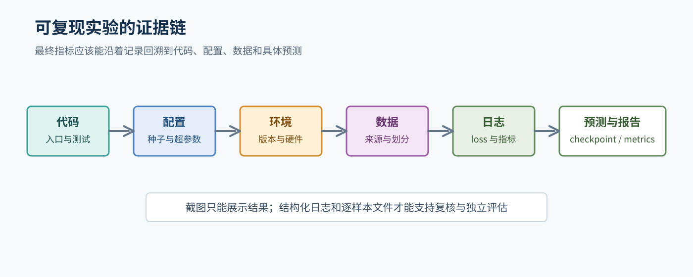
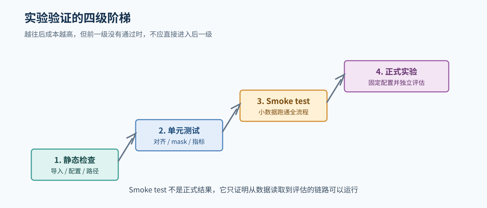
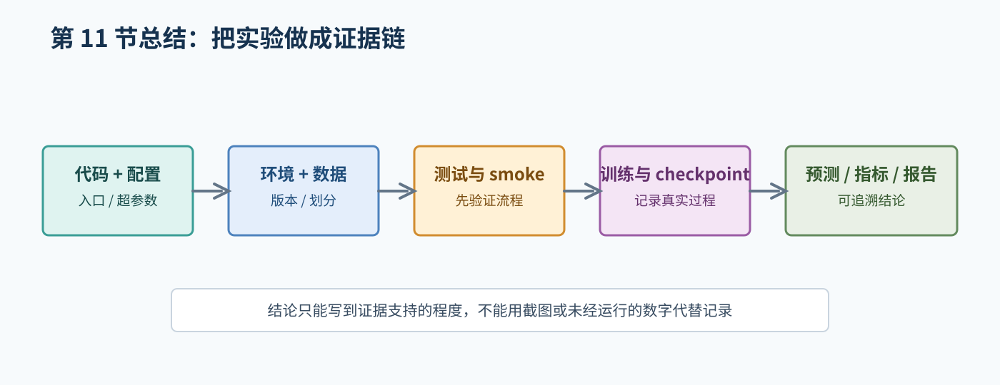

# 11. 实验工程与报告写作

## 1. 先把实验当作一个可追溯过程

一个可信的实验不是“运行一次命令得到一个数字”，而是：

```text
代码 + 配置 + 环境 + 数据版本 + 日志 + checkpoint + 预测文件
```



图 1：结构化配置、日志、预测文件和指标共同组成可追溯的实验记录。

别人或未来的你应该能够回答：这个数字来自哪一份数据、哪个 checkpoint、哪套 tokenizer、哪组生成参数和哪条评估命令。

## 2. 建议的文件组织

可以根据仓库现有结构逐步补充：

```text
configs/                 # YAML/JSON 配置
scripts/                 # 训练、评估、推理入口
tests/                   # 对齐、mask、指标和抽取测试
outputs/
  experiment_name/
    config.json
    train.log
    predictions.jsonl
    metrics.json
    checkpoint/           # 大文件按项目规则处理
```

大型数据集、模型权重、缓存、密钥和个人凭据不应提交到仓库。实际目录可以按项目约定调整，但配置、日志和结果文件要能互相对应。

## 3. 配置而不是散落硬编码

配置文件至少保存：

- 随机种子。
- 数据路径和数据集版本。
- 模型标识。
- tokenizer。
- batch size、学习率、epoch、最大长度。
- 评估和解码参数。
- LoRA 参数或 Transformer 结构参数。

如果为了调试临时改了一个参数，也要让最终日志记录实际值。不能只在命令历史中依赖人的记忆。

## 4. 验证层级

### 4.1 静态检查

先保证代码能导入、格式基本一致、路径和配置字段有效。必要时使用项目已经采用的 formatter 或 linter。

### 4.2 单元测试

高风险逻辑应有小测试：

- tokenization 和 padding。
- NER subword 标签对齐。
- BIO/BIOES 实体解析。
- Transformer mask。
- 数学答案抽取和归一化。
- 从预测文件独立重算指标。

### 4.3 Smoke test

使用极小数据和小模型或短运行配置完成：

- 数据读取。
- 前向计算。
- 反向和参数更新。
- checkpoint 保存/加载。
- 推理。
- 评估。

Smoke test 只证明流程可以运行，不是正式实验结果。

### 4.4 正式实验

正式实验前固定配置和数据划分，记录环境版本和硬件。完整训练没有运行，或者中途失败，都必须如实记录。



图 2：先通过低成本检查，再进入 smoke test 和正式训练。

## 5. 随机性和可重复性

固定随机种子通常涉及 Python、NumPy、PyTorch 和数据加载器。但固定种子不能保证所有硬件和算子完全确定。报告应记录：

- Python 版本。
- PyTorch、Transformers、PEFT 等版本。
- CUDA 和 GPU 信息（如果使用）。
- 随机种子。
- 是否启用了确定性设置。

可复现的目标不是承诺所有机器得到完全相同的小数，而是让变化来源可解释。

## 6. 报告的证据链

建议每个实验都按下面的结构写：

1. **背景和问题**：输入、输出和应用价值。
2. **研究现状**：引用可靠的教材、原始论文或官方文档，说明方法处于什么发展脉络。
3. **数据和预处理**：来源、许可证、字段、划分、tokenizer 和清洗。
4. **模型和算法**：结构、训练目标、mask、冻结策略和关键配置。
5. **实验设置**：硬件、软件版本、随机种子、超参数和 checkpoint 选择。
6. **结果**：来自结构化文件的指标和样例。
7. **分析**：错误类型、基线比较、局限和可能原因。
8. **总结**：只总结已验证的事实，区分未来工作。

## 7. 不要写成没有证据的结论

下面这些句子都需要证据支持：

- “模型显著优于基线”：需要明确指标、数据集和比较设置。
- “数据量不足导致效果差”：需要数据规模、训练曲线或错误分析支持；否则只能写成可能原因。
- “LoRA 大幅节省显存”：需要记录实际参数量和显存测量，理论参数量不能替代实测。
- “模型能够理解复杂数学”：需要任务定义和测试结果，单个样例不能支持泛化结论。

没有运行的数据、没有确认的来源和没有提供的组员信息都应标记为待确认。

## 8. 组员分工记录

课程要求介绍每位组员的具体工作。不要用“共同完成”代替具体内容。可以记录：

- 数据准备与许可证核对。
- 模型和训练代码。
- 指标与测试。
- 运行日志和错误分析。
- 报告某章节撰写与复核。

姓名、学号、组号和真实分工在用户提供前使用占位符，不应猜测。

## 9. 本章自测

1. 为什么配置文件和日志比截图更适合复现？
2. 单元测试、smoke test 和正式训练分别验证什么？
3. 为什么只固定随机种子仍不能保证完全一样？
4. 一个“模型效果不好”的结论至少需要哪些证据？
5. 如何让一张报告表追溯到原始预测文件？

## 本章总结框图



图：本章总结代码、配置、环境、数据、测试、训练和报告之间的证据链。
