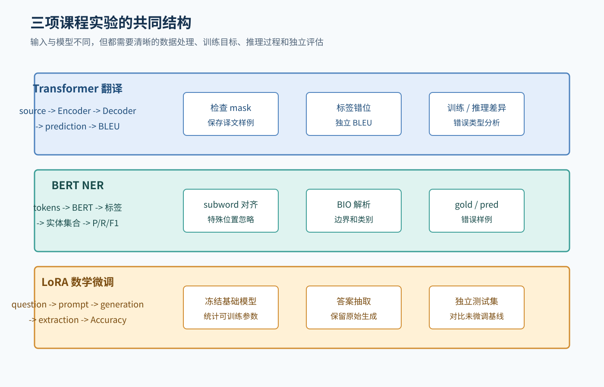
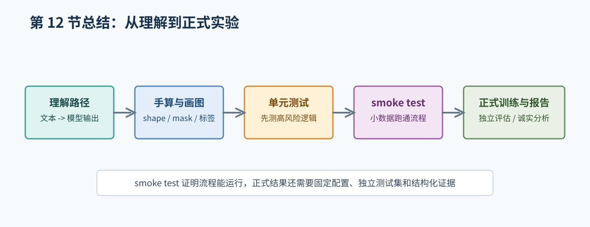

# 12. 综合练习与检查清单

## 1. 综合练习 A：从文本到 token

对句子“张三在北京大学学习机器学习。”，先使用字符级切分；另构造一条更短的句子组成 batch，并在较短句末尾补 `<pad>`。使用给定的小词表，写出两条样本的 token、id 和 `attention_mask`，避免不同切分方案导致答案无法比较。

完成：

1. 写出两条样本的 token、id 和 padding 位置。
2. 分别说明 attention mask、causal mask 和 loss 的 `ignore_index` 控制什么。
3. 如果用于字符级 NER，写出 BIO 标签；说明 tokenizer 拆分字符时怎样对齐标签。
4. 标明 `[CLS]`、`[SEP]`、padding 是否参与 attention、loss 和实体评估。

## 2. 综合练习 B：画出三个模型

分别画出以下数据流：

### Transformer 翻译

```text
source -> Encoder -> Decoder + target prefix -> target logits
```

标出源 padding mask、目标 causal mask、目标 label 和 cross-attention。

### BERT NER

```text
tokens -> BERT Encoder -> per-token classifier -> BIO labels
```

标出 `[CLS]`、`[SEP]`、padding、subword 对齐和实体解析。

### LoRA 数学生成

```text
question -> prompt -> base model + LoRA -> generation -> extraction -> accuracy
```

标出冻结参数、可训练参数、测试集和基线。



图 1：三项实验的模型不同，但都需要记录输入、训练目标、推理过程和独立评估。

## 3. 综合练习 C：错误定位

遇到下面现象时，优先检查什么：

| 现象 | 优先检查 |
| --- | --- |
| loss 一直为 NaN | 输入数值、学习率、softmax/logits 计算和数据异常 |
| NER 预测长度不对 | tokenizer、subword 对齐、特殊 token 和 padding |
| Transformer 训练分数很好但推理全错 | causal mask、输入标签错位、解码和 checkpoint |
| BLEU 为 0 | 预测文件格式、特殊 token、分词配置和参考译文 |
| LoRA 没有参数更新 | target modules、`requires_grad` 和 optimizer 参数组 |
| 数学 Accuracy 很低但输出看似正确 | 答案抽取、归一化和判分规则 |
| 测试结果异常高 | 数据重复、泄漏、测试集参与调参或评估脚本错误 |

这不是自动诊断答案，而是排查顺序。最终原因必须通过日志、样例和测试确认。

## 4. 按阶段验收实验

本节清单分为训练前、各实验专项检查和训练后验收；不能在训练前勾选尚未产生的预测或指标。

### 4.1 通用训练前

- [ ] 我能说明任务输入、输出和训练目标。
- [ ] 我能打印一条预处理后的真实样本。
- [ ] 我知道训练、验证和测试的用途。
- [ ] 我已经固定并记录随机种子、软件版本和硬件。
- [ ] 数据、标签、划分和配置已核对。
- [ ] 单元测试和 smoke test 有真实入口和通过条件。

### 4.2 机器翻译专项检查

- [ ] 源/目标语言、数据版本、tokenizer 和特殊 token id 已记录。
- [ ] Decoder 输入与 label 右移一位，且形状一致。
- [ ] padding mask、causal mask 和 loss ignore 已分别测试。
- [ ] BLEU 的实现、划分和配置已固定。

### 4.3 NER 专项检查

- [ ] BIO/BIOES 方案和真实数据标签表已确定。
- [ ] 一条 subword 对齐表已人工检查。
- [ ] 特殊 token、padding、后续 subword 的 attention/loss/评估处理已区分。
- [ ] 实体解析器有手工测试，指标采用实体级 P/R/F1。
- [ ] CLUENER 当前 `dev` 有标签，可计算指标；`test` 无标签，只能保存预测。

### 4.4 LoRA 数学微调专项检查

- [ ] 基础模型和数据集来源、版本与划分已记录。
- [ ] prompt、训练 labels 和答案格式已保存。
- [ ] LoRA 参数统计能证明基础模型冻结且适配器可训练。
- [ ] 原始 generation、答案抽取、归一化和判分规则已测试。
- [ ] 未微调基线与 LoRA 使用同一套测试及评估规则。

### 4.5 训练后与报告前

- [ ] checkpoint 由验证集选择，测试信息未用于调整模型、prompt、解码或判分规则。
- [ ] 保存了训练日志、checkpoint、逐样本预测和独立复算指标。
- [ ] 机器翻译预测包含 source/reference/prediction，NER 只在有 gold 的划分报告实体指标。
- [ ] 报告表格、图和结论能追溯到配置、日志、checkpoint、预测和指标文件。
- [ ] 失败、未运行或无法核验的步骤已如实标注。

## 5. 学习完成标准

你不需要一次记住所有公式，但应能够：

1. 看懂一条样本从文本到模型输出的完整路径。
2. 解释 Transformer 中 attention、mask、Encoder 和 Decoder 的作用。
3. 解释 BERT 为什么能做 NER，以及 subword 对齐为什么重要。
4. 解释 GPT 类模型为什么逐 token 生成，以及 LoRA 更新了什么。
5. 对指标、日志和错误样例保持审慎，不把未经验证的结果写成事实。

## 6. 下一步行动

按下面的顺序推进本仓库：

1. 阅读对应实验 README，确认课程硬性要求。
2. 完成本手册和专项材料中的自测题。
3. 选择并记录数据集、模型和配置，不先编造结果。
4. 先实现数据检查、指标和最小 smoke test。
5. 再进行受控训练和独立评估。
6. 最后依据结构化日志和预测文件写报告，并核对背景、方法、结果分析、总结、三位组员的实际分工和提交格式要求。

完整训练可能需要较多算力。在没有确认硬件、数据和配置前，不要直接启动昂贵的完整训练。

## 本章总结框图



图：本章把理解、画图、测试、smoke test、正式训练和报告连接成执行顺序。
